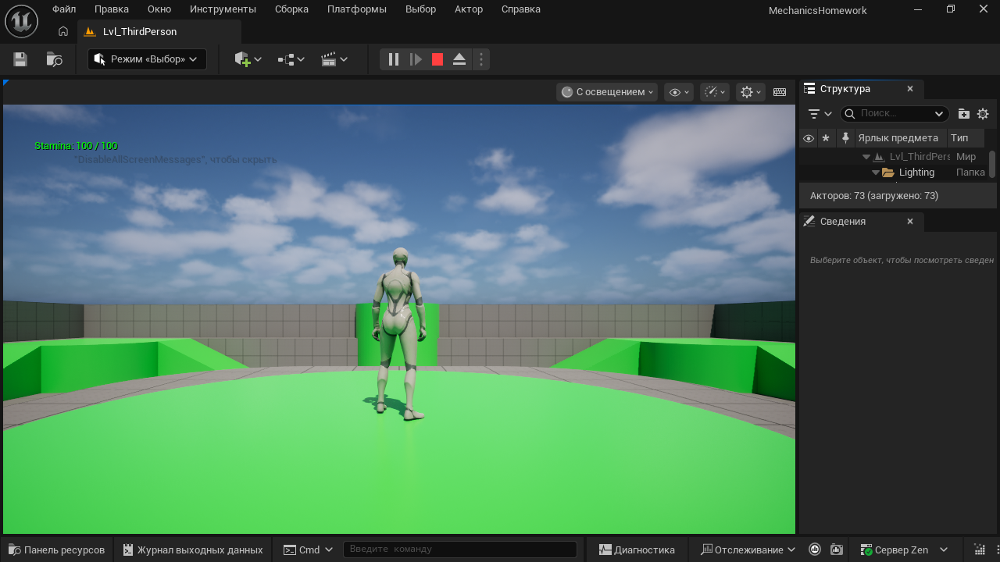
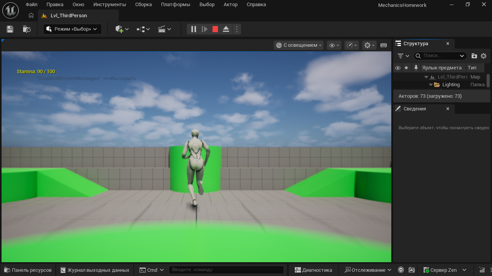
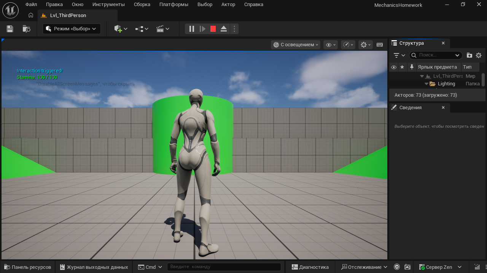

# Проверка готового проекта

Проверено 19 октября 2026 года (Europe/Moscow).

## Окружение

- Unreal Engine 5.8, Windows 11 x64.
- Visual Studio 2026, MSVC 14.51.36257, Windows SDK 10.0.22621.0.
- NVIDIA GeForce RTX 5070; визуальный запуск с D3D12.
- Движок сообщает, что установленный MSVC новее рекомендованного 14.50. Сборки завершились успешно; присутствуют предупреждения устаревших API в заголовках самого движка.

## Результаты

| Проверка | Результат |
|---|---|
| Независимые C++-тесты выносливости | PASS: расход, истощение, отпускание, восстановление, границы, 30/60/144 FPS |
| Development Editor Win64 | Сборка успешна |
| Development Game Win64 | Сборка успешна |
| Настройка и компиляция Blueprint commandlet | 0 ошибок, 0 предупреждений |
| `Homework.Gameplay.EndToEnd` без рендеринга | 1 успешный тест, 0 ошибок, 0 предупреждений |
| `Homework.Gameplay.EndToEnd` с рендерингом | 1 успешный тест, 0 ошибок, 0 предупреждений |
| Визуальная проверка | Карта и манекен отображаются; видны Stamina и `Interaction triggered!` |

## Что проверяет игровой тест

Тест открывает сохранённую карту и запускает Play In Editor. Нажатия проходят через настоящий PlayerController и Enhanced Input:

1. Стандартный GameMode создаёт `BP_ThirdPersonCharacter`, унаследованный от C++-класса.
2. Сохранены камера, AnimInstance и подписка `HandleInteraction` на Dynamic Multicast Delegate.
3. W перемещает персонажа, Shift увеличивает скорость до 900 и снижает выносливость.
4. Текущим состоянием машины Locomotion становится Sprint.
5. Пробел запускает прыжок во время спринта; внешняя машина выходит из наземной Locomotion.
6. После отпускания Shift и завершения приземления скорость восстанавливается, наземная машина возвращается в Idle.
7. Удержание E вызывает ровно одно событие, отпускание и новое нажатие — второе. В журнале Blueprint присутствуют два сообщения `Interaction triggered!`.
8. Удержание Shift дольше запаса выносливости останавливает спринт и восстанавливает обычную скорость.
9. Выносливость восстанавливается, но спринт сам не возобновляется.
10. Отпускание и повторное нажатие Shift снова запускает спринт.

Первая версия теста проверяла наземное состояние до завершения штатной анимации Land. Проверка исправлена: она ждёт завершения приземления. Итоговые тесты проходят и без графики, и с графикой.

## Снимки реального запуска







## Повторение проверки

```powershell
python Tests/run_tests.py
powershell -ExecutionPolicy Bypass -File Scripts/Verify.ps1
powershell -ExecutionPolicy Bypass -File Scripts/Verify.ps1 -Render
```

При нестандартном пути установки добавить `-EngineRoot "D:\Epic Games\UE_5.8"`. Отчёты создаются в `Saved/Verification`, изображения — в `Saved/Screenshots`. Скрипт проверяет JSON-результат тестов, поскольку одного кода завершения Unreal недостаточно.

Проверены сборки и локальный игровой режим, включая реальную графику. Упаковка дистрибутива, Shipping, другие версии Unreal, другие платформы и мультиплеер не проверялись и не входят в выполненный сценарий сдачи исходного проекта.
