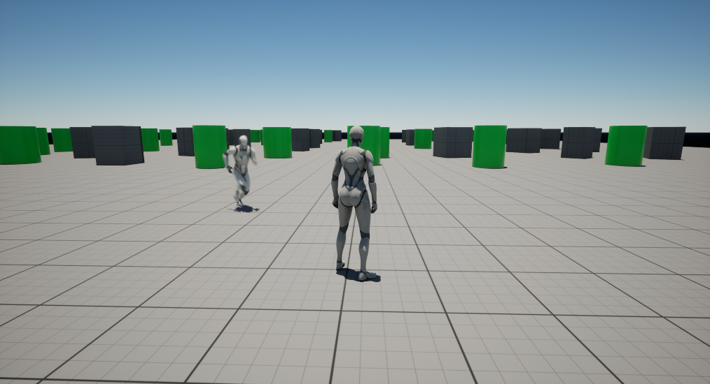

# Патрульный двор · Unreal Engine 5.8

Для второго ДЗ я сделал уровень `Lvl_PCGPatrol` в проекте из первого задания. На площадке два охранника. Если спокойно обойти колонну, можно скрыться из виду. Если пробежать за ней с зажатым Shift, охранник услышит шаги и пойдёт проверять, откуда они раздались.



## Запуск

Я собирал проект на Windows с Unreal Engine 5.8, Visual Studio с инструментами C++ и Windows SDK. Из корня репозитория запускаю сборку:

```powershell
powershell -ExecutionPolicy Bypass -File Scripts/Build.ps1
```

Затем открываю `MechanicsHomework.uproject` и нажимаю **Play**. По умолчанию загружается патрульный двор. Карта, дерево поведения, Blackboard и граф PCG лежат в `Content/Homework2`. Если UE установлен в другой папке, у скрипта сборки есть параметр `-EngineRoot`.

**Управление.** WASD — движение, мышь — камера, пробел — прыжок, левый Shift — спринт, E — взаимодействие.

## Как устроен двор

Я оставил свободную полосу по краю площадки, чтобы от охранника можно было оторваться. В центре граф `PCG_Courtyard` расставляет 64 препятствия. `Create Points Grid` задаёт сетку 8 × 8, `Transform Points` смещает, поворачивает и масштабирует точки, а `Static Mesh Spawner` выбирает для каждой точки блок или колонну. Чтобы получить другую расстановку, можно изменить **Seed** у PCG-компонента и нажать **Generate**.

Обе формы имеют коллизию. `NavMeshBoundsVolume` охватывает площадку, а Recast строит маршруты по проходам между препятствиями. В редакторе клавиша **P** показывает, где может пройти охранник.

## Что решает охранник

В `AHomeworkGuardController` я запускаю `BT_Guard` и подключаю слух. Сам маршрут задают задачи **Move To** в дереве. У каждого охранника свои значения в `BB_Guard`. Ветки дерева расположены слева направо в порядке приоритета.

| Ветка | Когда включается | Что делает охранник |
| --- | --- | --- |
| Погоня | Игрок на виду и ближе 11 м | Бежит к игроку со скоростью 6,5 м/с. Теряет цель за укрытием или на расстоянии больше 15 м. |
| Проверка шума | Цели не видно, но слышны шаги спринта в пределах 18 м | Идёт к последней услышанной точке. По прибытии ждёт 1,5 с. Новые шаги могут изменить маршрут. |
| Патруль | Цели и свежего шума нет | Выбирает случайную достижимую точку в радиусе 18 м от места появления. После короткой паузы цикл повторяется. |

Для обнаружения и потери игрока я взял разные радиусы, чтобы охранник не переключался между погоней и патрулём на каждом шаге у границы видимости. Декораторы с **Observer Aborts = Both** позволяют сразу прервать текущее движение при смене приоритета.

## Дополнительное задание на 9–10 баллов — шум спринта

Я связал слух со спринтом из ДЗ1. Персонаж посылает событие `UAISense_Hearing` раз в 0,4 с, пока бежит по земле быстрее 1 м/с. Можно удерживать Shift стоя или прыгнуть — шагов в эти моменты нет. Охранник записывает в `NoiseLocation` координаты последнего шага. Если после этого тихо свернуть за угол, он всё равно проверит прежнюю точку.

Для этого я добавил сервис `GuardAwareness` и задачу `GuardClearNoise`. Сервис раз в 0,15 с проверяет прямую видимость и сбрасывает шум через 6 с после последнего события. Задача завершает проверку, если охранник дошёл до актуальной точки и выждал паузу. Ещё одна задача, `GuardPatrolPoint`, выбирает следующую точку вокруг места появления.

**Как увидеть это в игре.** Открываю `BT_Guard`, запускаю Play и выбираю охранника в списке отладки дерева. На открытом месте подхожу к нему ближе 11 м — подсвечивается ветка погони. Затем забегаю за препятствие, продолжаю спринт несколько шагов и отпускаю Shift. В Blackboard очищается `TargetActor`, появляется `NoiseLocation`. Охранник доходит до места шагов или возвращается к патрулю, когда шум устаревает.

## Что осталось из первого ДЗ

На карте `Content/ThirdPerson/Lvl_ThirdPerson` можно отдельно проверить исходного персонажа. Спринт разгоняет его до 9 м/с. Полного запаса выносливости хватает на 4 с, после истощения нужно отпустить и снова нажать Shift. Клавиша E вызывает делегат `OnInteraction`, на который подписан Blueprint персонажа. На экране появляется `Interaction triggered!`. [Графы персонажа и анимации](Docs/BlueprintSetup.md)

## Проверка

```powershell
powershell -ExecutionPolicy Bypass -File Scripts/Verify.ps1
python Tests/run_tests.py
```

Первой командой я проверяю обе карты в Play In Editor. `Homework.AI.PatrolChaseNoise` считает препятствия, строит обходной путь вокруг одного из них, проверяет движение патруля, погоню и реакцию охранника на W + Shift. `Homework.Gameplay.EndToEnd` проверяет ввод, анимацию, взаимодействие и выносливость из первого ДЗ. JSON-отчёт сохраняется в `Saved/Verification`. Вторая команда запускает отдельные C++-тесты выносливости.
